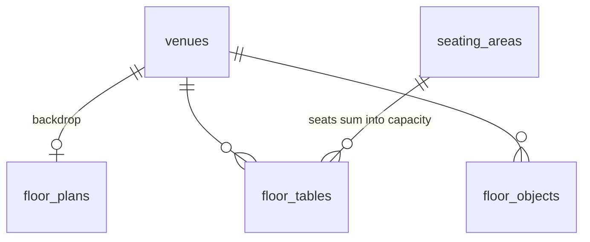
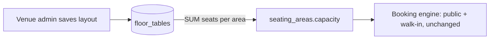

# Floor plan & seating

Production port of the prototype `docs/gioi_bali_2d_floor_plan.html`: a per-venue 2D floor plan whose tables drive seating-area capacity, plus the guest booking map.

Booking stays **area-level** (design doc §4, "start with seating-area capacity"). Tables do not get reservations; they define how many covers each area holds.

## Roles

| Action | Venue host | Venue admin | Super admin |
|---|---|---|---|
| View floor plan (admin) | – | yes | yes (preview) |
| Move / add / remove tables, chairs, objects | – | **yes** | **no** (unless also admin of that venue) |
| Upload / remove the backdrop drawing | – | – | **yes** |
| See read-only map while booking (guest) | public | public | public |

"Venue admin" means `user_venues.role = 'admin'` for that venue. The layout save checks `userRole(session, venueId) === 'admin'` and does **not** let super admin through by global rights. That is the one place this feature departs from `requireAdmin`.

## Data model (migrations `0002_floor_plan`, `0003_seating_area_zero_capacity`)



| Table | Columns | Rules |
|---|---|---|
| `floor_plans` | `venue_id` PK, `image` text NULL (data URL), `width` smallint (always 1200), `height` smallint, `updated_at` | image is NULL or `data:image/(svg+xml\|png\|jpeg\|webp);base64,…`, ≤ 4,000,000 chars; size 100–4000 |
| `floor_tables` | `id`, `venue_id`, `seating_area_id`, `seats`, `x`, `y`, `rotation` | FK `(seating_area_id, venue_id)` → `seating_areas(id, venue_id)`, so a table can't point at another venue's area; seats 1–16; rotation 0–359 |
| `floor_objects` | `id`, `venue_id`, `label`, `width`, `height`, `color`, `x`, `y`, `rotation` | size 20–600; label ≤ 24; color `#RRGGBB` |

### Plan space

- Units: the plan is `width × height` units. Width is fixed at **1200**. Height follows the uploaded drawing's aspect ratio (`round(1200 × h / w)`), and is 900 when there is no drawing.
- Table and object `x`/`y` is the **centre**; `rotation` is degrees clockwise.
- A table at 0° is horizontal, with chairs split over its two long sides. Icons are drawn at `TABLE_SCALE` (0.95), the same as the prototype.
- Changing the drawing keeps the stored positions. The editor clamps any item that ends up outside the new box when it loads.

## Capacity rule



- **The floor plan is the only place seating areas are managed.** A layout save carries the areas too: create (client-made uuid), rename, party limits, bookable, and delete. There is no separate seating-areas settings card or endpoint.
- When the layout is saved, in the **same transaction**, every area gets `capacity = SUM(seats)` of its tables; an area with no tables gets **0** and can't take bookings (migration `0003_seating_area_zero_capacity` relaxes the check to `capacity >= 0`). The row update takes the same row lock that booking transactions take (`SELECT … FOR UPDATE`).
- Deleting an area also deletes its tables. It is refused (409) while any reservation references it, so existing bookings are never orphaned.
- Lowering capacity never cancels existing bookings. It only blocks new ones.
- Audit: `floor_plan.updated` (table and object counts, per-area capacity changes, deleted area names), `floor_plan.image_uploaded`, and `floor_plan.image_removed`.

## API

| Method & path | Who | Body / query | Returns |
|---|---|---|---|
| `GET /admin/venues/:id/floor-plan` | venue admin, super admin | – | `AdminFloorPlan` |
| `PUT /admin/venues/:id/floor-plan/layout` | **venue admin only** | `{ areas: { id, name, bookable, minParty?, maxParty? }[], tables: FloorTable[], objects: FloorObject[] }` (≤ 50 areas, ≤ 500 tables, ≤ 200 objects). New areas use a client-made uuid. Areas not sent are deleted (blocked if they have reservations) | `AdminFloorPlan` |
| `PUT /admin/venues/:id/floor-plan/image` | **super admin only** | `{ image: string \| null, width?, height? }` (natural size of the drawing; required when `image` is set). Body limit 4.5 MB | `AdminFloorPlan` |
| `GET /public/venues/:slug/floor-plan` | public | – | `PublicFloorPlan` |
| `GET /public/venues/:slug/availability` | public | `date`, `party`, **`area` (optional uuid)** | slots for that area only, or across all areas when omitted |

The shared types live in `packages/domain/src/types.ts`: `FloorTable`, `FloorObject`, `FloorPlanArea`, `PublicFloorPlan`, `AdminFloorPlan`.

Errors: 403 `venue admin required` / `super admin required`; 409 `<area> has reservations and cannot be deleted`; 422 `unknown seating area`, `area name is required`, `area names must be unique`, `minParty must not exceed maxParty`, `item is outside the floor plan`, `drawing must be an SVG, PNG, JPEG or WebP under 3 MB`.

Uploaded SVGs are only ever rendered through SVG `<image href>`, which doesn't run scripts. They are never served or inlined as a document.

## Admin UX

- **`/admin/floor-plan`** (venue admins; nav link "Floor plan"): the prototype editor, saved to the DB.
  - Drag, arrow-key nudge (Shift = 10 units), R / buttons to rotate (±15°, Shift ±90°), +/− chairs (1–16), Delete key.
  - Add a table (it goes into the area picked in the toolbar) or an object (presets Stage, Bar, DJ booth, Entrance, Planter, Custom; label, W and H are editable).
  - Each table has a seating-area dropdown.
  - Side panel lists each area with its table count and seats; hover or click highlights that area. Total seats.
  - **+ Add area** creates an area. Click an area to edit its name, min/max party and Bookable, or to **Delete area** (also removes its tables; the save is refused if it has reservations). With no areas, + Table is disabled.
  - Explicit **Save layout** with an unsaved-changes indicator and **Revert** to reload.
  - Users without venue admin rights see the plan read-only.
- **`/admin/settings`** for super admins: "Floor plan drawing" upload, preview and remove for the venue chosen in the venue picker. Super admins have no "Floor plan" nav link, and `/admin/floor-plan` redirects them to Settings: laying out tables is the venue admin's job.
- **`/admin/settings`** for venue admins has **no** seating-areas card any more: names, party limits, bookable flags and capacity all live in the floor plan editor.

QA scenarios for all of the above: [`qa-e2e-browser-scenarios.md`](./qa-e2e-browser-scenarios.md) §1.2a and §7.2.

## Guest booking UX (`/[venue]/book`)

- There are **no Seating pills**. The guest picks a **seating area** by tapping a table on the venue map ("Pick a table area"). The booking stores the area, never a table.
- The map sits between Guests and Time, and only renders when the plan has tables. It is on a fixed light paper background, so uploaded drawings read correctly in dark mode.
- Tapping a table (or Enter / Space on a focused table; hit area is larger than the icon) opens a dialog: area name, "Table for N", and a fit message.
  - **Choose <area>** sets the area. Other areas' tables fade (opacity 0.22), "Selected: <area>" shows under the map, and the booking summary shows it. Choose is disabled when the area isn't bookable online or the party is outside its min/max.
  - If the table seats fewer than the party, the dialog says the party is seated in the area, not at that exact table.
  - On the selected area's tables the button is **Clear**, which goes back to "Any available table".
  - Esc, the backdrop and Close dismiss it. On a phone it is a bottom sheet.
- If the party changes and the selected area no longer fits, the selection is cleared.
- Time slots are fetched for the selected area (`area` query), so the grid matches what the server will accept.
- With no area chosen the booking sends no `seatingAreaId`, so the server picks the area (`pickAreaForParty`).

## Booking fixes shipped with this feature

| Was | Now |
|---|---|
| "Anywhere" sent the smallest-capacity area, chosen in the browser from an empty reservation list, so bookings piled into Chef's Counter and got false "full" errors | `seatingAreaId` is sent only when the guest picked an area |
| Slots ignored the picked area | `area` query param; domain `getDayAvailability(…, { seatingAreaId })` |
| Confirm button disabled with no reason when the area's party rules failed | Pills that don't fit are disabled and show the reason |
| The server didn't check an explicitly picked area's `minParty`/`maxParty` | Checked in the booking transaction (422) |
| Availability loaded every reservation the venue ever had | Query filtered to the requested day |
| Settings "Add seating area" created `area-xxxx` ids, which the uuid schema rejected | Areas are now created in the floor plan editor with real uuids; the settings card and its endpoints are gone |

## Operations

```sh
cd apps/api
pnpm prisma:migrate    # applies 0002_floor_plan and 0003_seating_area_zero_capacity
pnpm prisma:generate   # regenerates src/generated/prisma
pnpm prisma:seed       # stores the Bali drawing (prisma/floor-plans/bali.svg) only if Bali has none yet
```

The seed does not create tables: production seating areas (Main Hall, Sunset Terrace, …) don't match the prototype's zones. The Bali venue admin lays out the tables once in `/admin/floor-plan`. Until then the guest map stays hidden.

**Existing venues:** the first layout save sets every area's capacity to its seat count, so areas that had a typed capacity and no tables drop to 0 and stop taking bookings until tables are placed. Place the tables before saving, or the venue closes those areas.

## Known limits (ponytail)

- A layout save replaces all rows, so table ids change on every save. Switch to per-id upsert once reservations reference tables.
- Icon size is fixed in plan units. A drawing at a very different scale makes tables look too big or too small. Add a per-venue table scale only once a second real drawing needs it.
- No table-level assignment or host floor view. Both are deliberately out of scope until GIOI's floor rules ask for them.
