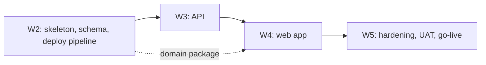
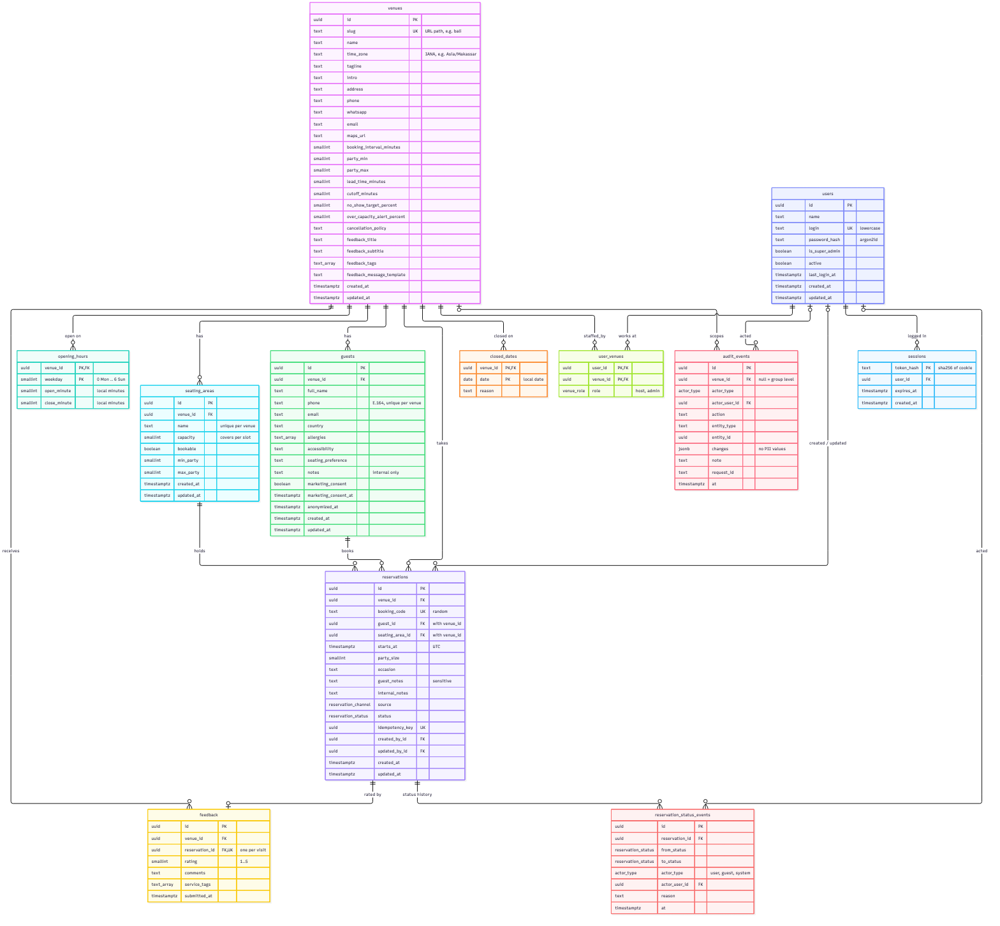

# GIOI Bali Execution Strategy

**Date:** 2026-11-07
**Status:** Draft for the build in weeks 2–5.
**Inputs:** `gioi_infrastructure_decision.md` (stack, hosting, domains), `gioi_hosting_recommendation.md` (setup steps, security checklist), `gioi_reservation_platform_design.md` (lifecycle, minimum data model, privacy rules), `prototype/src/domain` (business rules), Neon [postgres-best-practices](https://github.com/neondatabase/postgres-skills/tree/main/skills/postgres-best-practices) (schema design, indexing, isolation, roles, pooling).

Claims marked **[verify]** depend on library or platform behaviour that must be checked on the first deploy in week 2.

## 1. Monorepo

One Git repository, pnpm workspaces. The prototype already uses pnpm. No Turborepo or Nx: two apps and one package do not need a task graph, and `pnpm -r` / `pnpm --filter` cover build and test.

```text
gioi/
├── apps/
│   ├── web/                 Nuxt 3/4. book.gioigroup.com + admin.gioigroup.com
│   │   ├── pages/[venue]/   index (prerendered landing), book, confirmation/[code], feedback/[code]
│   │   ├── pages/           login, host, guests/[id], admin/*  (staff, client-rendered)
│   │   ├── server/middleware/host-routes.ts   404 staff routes on book., guest routes on admin.
│   │   └── vercel.json      sin1 + /api rewrite to the API project
│   └── api/                 Fastify. The only code that touches the database
│       ├── prisma/          schema.prisma, migrations/, seed.ts
│       ├── prisma.config.ts
│       ├── src/routes/      public/*, staff/*
│       ├── src/db.ts        Prisma client, created once per function instance
│       └── vercel.json      sin1
├── packages/
│   └── domain/              Pure TS ported from prototype/src/domain + its Vitest tests
├── prototype/               Untouched (recording scripts depend on it)
├── docs/
├── .github/workflows/       ci.yml, backup.yml
├── pnpm-workspace.yaml      apps/*, packages/*
└── package.json             root scripts only: lint, test, typecheck
```

| Decision | Why |
|---|---|
| `packages/domain` is the only shared package | The API enforces the rules (status transitions, slot generation, party limits). The web app uses the same functions to render slots and status buttons. Two copies would drift. |
| Prisma lives in `apps/api`, not a `packages/db` | Only the API queries the database (`gioi_reservation_platform_design.md` §6: the landing page must not write to the database). |
| API response types exported from `packages/domain` | One definition for the JSON both sides see. No codegen, no tRPC. |
| `prototype/` stays outside the workspace globs | `AGENTS.md`: do not change it to match production. |

Vercel setup for the monorepo:

- Two Vercel projects, Root Directory `apps/web` and `apps/api`.
- Enable **Include files outside the root directory** so builds see `packages/domain`.
- Enable **Skip deployments when there are no changes to the root directory or its dependencies**, so an API-only commit does not rebuild the web app.
- `packages/domain` exports TypeScript source. Nuxt compiles it. The Fastify function bundle must compile it too **[verify]**. If it does not, add a `tsc` build step to the package.

## 2. Build order



### Week 2: Skeleton, database and deploy pipeline

1. Create the workspace layout above. Port `prototype/src/domain` and its tests into `packages/domain`, replacing `new Date()` local-time maths with functions that take the venue's IANA zone (see §3.2).
2. Create the Neon project in `aws-ap-southeast-1` (hosting guide step 1). Create the `gioi_app` role in SQL (§3.6).
3. Write `schema.prisma` (§3.4) and the first migration, then hand-add the CHECK constraints and grants (§3.5). Seed the Bali venue from `prototype/src/mock/settings.json`.
4. Deploy an empty Fastify app with `/health` that runs `SELECT 1`, and an empty Nuxt app. Both in `sin1`. Install the Neon-Managed Vercel integration.
5. CI (`ci.yml`): `pnpm install --frozen-lockfile`, typecheck, `pnpm -r test`, `prisma validate`.

**Exit:** a preview deployment answers `/api/health` through the web app's rewrite, the deployment summary shows `sin1`, and the preview has its own Neon branch with the migrated schema.

### Week 3: API

Public endpoints (venue derived from the slug, never from the body):

| Method | Path | Notes |
|---|---|---|
| GET | `/public/venues/:slug` | Landing data, opening hours, policies. Cacheable. |
| GET | `/public/venues/:slug/availability?date=` | Slots in venue time. Reads only. |
| POST | `/public/venues/:slug/reservations` | Turnstile token, idempotency key, capacity transaction (§3.3). Returns booking code. |
| GET | `/public/reservations/:code` | Confirmation. No phone, allergies or notes in the response. |
| POST | `/public/reservations/:code/cancel` | Guest cancel inside the policy window. |
| POST | `/public/reservations/:code/feedback` | Only when status is `completed`. One per reservation. |

Staff endpoints (session cookie, venue checked against `user_venues` on every request):

| Area | Endpoints |
|---|---|
| Auth | `POST /staff/login`, `POST /staff/logout`, `GET /staff/me` |
| Host | Day view, create (phone, walk-in), edit, status transition, guest profile and history |
| Admin | Venue settings, opening hours, closed dates, seating areas, users, audit log, dashboard metrics, CSV export |

Rules for every handler:

- Fastify JSON Schema on body, params and query.
- One transaction per write, a few round trips per request (hosting guide §2).
- Every write appends an `audit_events` row in the same transaction.
- Status changes use `canTransition` from `packages/domain` and an atomic guarded update (§3.3).

**Exit:** API integration tests run against a Neon branch and cover double booking under concurrency, cross-venue access (a Bali host requesting a Jakarta reservation gets 404), and every status transition.

### Week 4: Web app

1. Port views and components from the prototype into Nuxt pages. Pinia keeps UI state only, and data comes from the API.
2. Prerender `/bali` with the hero visible in HTML, `useSeoMeta`, and `Restaurant` JSON-LD (hosting guide §9).
3. Client-render `/bali/book/**` and the staff routes. The host screen and dashboard poll every few seconds.
4. Nitro middleware serves only guest routes on `book.` and only staff routes on `admin.`, and returns 404 for the rest.

**Exit:** the booking flow and the host flow from `gioi_prototype_usecase_scenarios.md` pass on a preview URL on a tablet and on a throttled mobile profile.

### Week 5: Hardening and go-live

1. Vercel Firewall rate-limit rules and Turnstile on the booking form.
2. `backup.yml`: nightly `pg_dump`, encrypted with `age`, to R2. Run one restore test before go-live.
3. `staging` custom environment on its own Neon branch for UAT with GIOI.
4. Chope/spreadsheet import as a separate script run once against staging, then production (design doc §3.4).
5. Domains, CNAMEs at Rumahweb, `/bali` 301, UptimeRobot, Spend Management (hosting guide §5–8).
6. Walk through the hosting guide's security checklist.

**Exit:** UAT sign-off, restore test passed, checklist complete.

## 3. Database requirements analysis

### 3.1 What the data must support

| Requirement | Source | Database consequence |
|---|---|---|
| Multi-outlet from the first migration | Decision 6 | `venue_id` on every outlet-owned table. Composite indexes lead with `venue_id`. |
| Times correct per outlet zone | Decision 6 | `timestamptz` everywhere. Venue stores the IANA zone. "Today" becomes a UTC range computed in the API. |
| No double booking | Design §3.1, §8 | Capacity check and insert in one transaction, serialized per seating area by a row lock. |
| Status history, not just current status | Design §4 | Append-only `reservation_status_events`. |
| Immutable audit trail | Design §8, hosting checklist | `audit_events` with UPDATE and DELETE revoked from the app role. |
| Idempotent status updates and submits | Design §8 | Guarded `UPDATE … WHERE status = $expected`. Unique `idempotency_key` on reservations. |
| Guest PII under UU PDP: export and deletion | Design §8, hosting checklist | Guests are per venue. Deletion is in-place anonymisation. The audit log never stores PII values. |
| Marketing consent separate from booking consent | Design §8 | `marketing_consent` + `marketing_consent_at` on guests. Feedback never sets it. |
| Public pages never show allergies, phone or notes | Design §5 | Public endpoints select explicit columns. Booking codes are random, not sequential. |
| Staff access per venue | Decision 5 | `user_venues(user_id, venue_id, role)` + `users.is_super_admin`. |
| Sessions survive across function instances | Decision 2 (no in-memory state) | `sessions` table, token stored as a SHA-256 hash. |
| Restaurant-scale volume | 100 seats, one outlet | Thousands of rows a year. No partitioning, no BRIN, no materialised views. Dashboard metrics are plain aggregates on indexed ranges. |

### 3.2 Time model

The prototype stores `date` + `time` strings in the device's zone. Production stores one column:

- `reservations.starts_at timestamptz`, the slot start in UTC.
- `venues.time_zone text`, for example `Asia/Makassar`.
- Opening hours stay in local wall-clock minutes (`open_minute`, `close_minute` as `smallint`, 0–1440), because "opens at 10:00" is a local rule that must not shift. `smallint` minutes avoid Prisma's awkward `DateTime @db.Time` mapping and match `toMinutes()` in the prototype.
- The API converts a local `(date, HH:MM)` to `starts_at` with the venue zone. Day views query `venue_id = $1 AND starts_at >= $dayStartUtc AND starts_at < $nextDayStartUtc`.
- Prisma maps `DateTime` to `timestamp(3)` **without** a time zone by default. Every `DateTime` field in the schema carries `@db.Timestamptz(6)` or `@db.Date`.

Bali has no daylight saving, so a local day is always 24 hours. If a future outlet's zone has DST, the range computation still holds because it is done per date in the API.

### 3.3 Capacity and concurrency

The prototype's rule (`reservedCovers` in `availability.ts`) is: covers already booked in the **same area at the same slot** with an active status (`pending`, `confirmed`, `arrived`, `seated`), plus the new party, must not exceed the area capacity.

That is a sum across rows, so a unique or exclusion constraint cannot express it. Under READ COMMITTED, "read the sum, then insert" lets two concurrent bookings both pass. The fix from the isolation reference is to lock before reading:

```ts
await prisma.$transaction(async (tx) => {
	// Serializes bookings per seating area. Other areas are not blocked.
	const [area] = await tx.$queryRaw<{ capacity: number }[]>`
		SELECT capacity FROM seating_areas
		WHERE id = ${areaId}::uuid AND venue_id = ${venueId}::uuid AND bookable
		FOR UPDATE`
	if (!area) throw unavailable('no_area')

	const [{ used }] = await tx.$queryRaw<{ used: number }[]>`
		SELECT coalesce(sum(party_size), 0)::int AS used FROM reservations
		WHERE seating_area_id = ${areaId}::uuid AND starts_at = ${startsAt}
		  AND status IN ('pending', 'confirmed', 'arrived', 'seated')`
	if (used + partySize > area.capacity) throw unavailable('full')

	const reservation = await tx.reservation.create({ data })
	await tx.reservationStatusEvent.create({ data: firstEvent(reservation) })
	await tx.auditEvent.create({ data: auditCreated(reservation) })
	return reservation
})
```

- When the guest does not choose an area, the API ranks candidate areas with `remainingCapacityForParty` and locks them **in id order** to avoid deadlocks.
- Status changes are a single guarded statement, so two hosts tapping at once cannot both win: `UPDATE reservations SET status = $to, updated_at = now() WHERE id = $id AND venue_id = $venue AND status = $from`. Zero rows updated means 409 Conflict.
- A double-submitted booking form carries the same `idempotency_key`. The unique index rejects the second insert, and the API returns the first reservation.
- Walk-ins go through the same capacity check. Whether a host may override it is open item 3 in §5.

> **Gap found in the prototype rule:** capacity counts only reservations at the exact same slot. A party seated at 19:00 is not counted against 19:30, so the 19:30 slot can be fully rebooked while the 19:00 guests are still at the table. Production should add `venues.dining_minutes` (for example 120) and count reservations whose `[starts_at, starts_at + dining_minutes)` overlaps the new one. The lock stays the same, and the sum query changes to a range condition. **Open item for GIOI: typical table time per party size.**

### 3.4 Prisma schema

Conventions applied from the Neon reference:

- `snake_case` table and column names through `@@map` / `@map`. No quoted mixed-case identifiers in SQL.
- UUIDv7 primary keys (`@default(uuid(7))`), generated by Prisma, so inserts stay index-local and IDs do not reveal row counts. This works on any Postgres version.
- `text` for strings (Prisma's default), with length limits as CHECK constraints rather than `varchar(n)`.
- Postgres enums for small, stable sets (status, channel, role).
- Every foreign key column has an index, either explicit or as the leading column of a composite key. Postgres does not create them automatically.
- Composite foreign keys `(seating_area_id, venue_id)` and `(guest_id, venue_id)` make it impossible to attach a Jakarta guest or area to a Bali reservation, even if the API has a bug.

```prisma
generator client {
  provider = "prisma-client"
  output   = "../src/generated/prisma"
}

datasource db {
  provider = "postgresql"
}

enum ReservationStatus {
  pending
  confirmed
  arrived
  seated
  completed
  cancelled
  no_show

  @@map("reservation_status")
}

enum Channel {
  website
  instagram
  google
  whatsapp
  walk_in
  phone
  host
  chope_import

  @@map("reservation_channel")
}

enum VenueRole {
  host
  admin

  @@map("venue_role")
}

enum ActorType {
  user
  guest
  system

  @@map("actor_type")
}

model Venue {
  id                       String   @id @default(uuid(7)) @db.Uuid
  slug                     String   @unique // URL path: book.gioigroup.com/<slug>
  name                     String
  timeZone                 String   @map("time_zone") // IANA, e.g. Asia/Makassar
  tagline                  String
  intro                    String
  address                  String
  phone                    String
  whatsapp                 String
  email                    String
  mapsUrl                  String   @map("maps_url")
  bookingIntervalMinutes   Int      @default(30) @map("booking_interval_minutes") @db.SmallInt
  partyMin                 Int      @default(1) @map("party_min") @db.SmallInt
  partyMax                 Int      @default(8) @map("party_max") @db.SmallInt
  leadTimeMinutes          Int      @default(60) @map("lead_time_minutes") @db.SmallInt
  cutoffMinutes            Int      @default(120) @map("cutoff_minutes") @db.SmallInt
  noShowTargetPercent      Int      @default(8) @map("no_show_target_percent") @db.SmallInt
  overCapacityAlertPercent Int      @default(85) @map("over_capacity_alert_percent") @db.SmallInt
  cancellationPolicy       String   @map("cancellation_policy")
  feedbackTitle            String?  @map("feedback_title")
  feedbackSubtitle         String?  @map("feedback_subtitle")
  feedbackTags             String[] @map("feedback_tags")
  feedbackMessageTemplate  String   @map("feedback_message_template")
  createdAt                DateTime @default(now()) @map("created_at") @db.Timestamptz(6)
  updatedAt                DateTime @updatedAt @map("updated_at") @db.Timestamptz(6)

  openingHours OpeningHours[]
  closedDates  ClosedDate[]
  seatingAreas SeatingArea[]
  guests       Guest[]
  reservations Reservation[]
  feedback     Feedback[]
  userVenues   UserVenue[]
  auditEvents  AuditEvent[]

  @@map("venues")
}

model OpeningHours {
  venueId     String @map("venue_id") @db.Uuid
  weekday     Int    @db.SmallInt // 0 = Monday … 6 = Sunday
  openMinute  Int    @map("open_minute") @db.SmallInt // minutes after local midnight
  closeMinute Int    @map("close_minute") @db.SmallInt

  venue Venue @relation(fields: [venueId], references: [id], onDelete: Cascade)

  @@id([venueId, weekday])
  @@map("opening_hours")
}

model ClosedDate {
  venueId String   @map("venue_id") @db.Uuid
  date    DateTime @db.Date // local date in the venue zone
  reason  String?

  venue Venue @relation(fields: [venueId], references: [id], onDelete: Cascade)

  @@id([venueId, date])
  @@map("closed_dates")
}

model SeatingArea {
  id        String   @id @default(uuid(7)) @db.Uuid
  venueId   String   @map("venue_id") @db.Uuid
  name      String
  capacity  Int      @db.SmallInt // total covers per slot
  bookable  Boolean  @default(true)
  minParty  Int?     @map("min_party") @db.SmallInt
  maxParty  Int?     @map("max_party") @db.SmallInt
  createdAt DateTime @default(now()) @map("created_at") @db.Timestamptz(6)
  updatedAt DateTime @updatedAt @map("updated_at") @db.Timestamptz(6)

  venue        Venue         @relation(fields: [venueId], references: [id])
  reservations Reservation[]

  @@unique([venueId, name])
  @@unique([id, venueId]) // target of the composite FK from reservations
  @@map("seating_areas")
}

model Guest {
  id                 String    @id @default(uuid(7)) @db.Uuid
  venueId            String    @map("venue_id") @db.Uuid
  fullName           String    @map("full_name")
  phone              String? // E.164, normalized at intake. Null for some walk-ins and after anonymisation
  email              String?
  country            String?
  allergies          String[]
  accessibility      String?
  seatingPreference  String?   @map("seating_preference")
  notes              String? // internal only
  marketingConsent   Boolean   @default(false) @map("marketing_consent")
  marketingConsentAt DateTime? @map("marketing_consent_at") @db.Timestamptz(6)
  anonymizedAt       DateTime? @map("anonymized_at") @db.Timestamptz(6)
  createdAt          DateTime  @default(now()) @map("created_at") @db.Timestamptz(6)
  updatedAt          DateTime  @updatedAt @map("updated_at") @db.Timestamptz(6)

  venue        Venue         @relation(fields: [venueId], references: [id])
  reservations Reservation[]

  @@unique([venueId, phone]) // NULLs are distinct, so phoneless guests do not collide
  @@unique([id, venueId])
  @@map("guests")
}

model Reservation {
  id             String            @id @default(uuid(7)) @db.Uuid
  venueId        String            @map("venue_id") @db.Uuid
  bookingCode    String            @unique @map("booking_code") // random, e.g. GIOI-7KQ2MX9P
  guestId        String            @map("guest_id") @db.Uuid
  seatingAreaId  String            @map("seating_area_id") @db.Uuid
  startsAt       DateTime          @map("starts_at") @db.Timestamptz(6)
  partySize      Int               @map("party_size") @db.SmallInt
  occasion       String?
  guestNotes     String?           @map("guest_notes") // sensitive, never in public responses
  internalNotes  String?           @map("internal_notes")
  source         Channel
  status         ReservationStatus
  idempotencyKey String?           @unique @map("idempotency_key") @db.Uuid
  createdById    String?           @map("created_by_id") @db.Uuid // null = guest or system
  updatedById    String?           @map("updated_by_id") @db.Uuid
  createdAt      DateTime          @default(now()) @map("created_at") @db.Timestamptz(6)
  updatedAt      DateTime          @updatedAt @map("updated_at") @db.Timestamptz(6)

  venue        Venue                    @relation(fields: [venueId], references: [id])
  guest        Guest                    @relation(fields: [guestId, venueId], references: [id, venueId])
  seatingArea  SeatingArea              @relation(fields: [seatingAreaId, venueId], references: [id, venueId])
  createdBy    User?                    @relation("ReservationCreatedBy", fields: [createdById], references: [id])
  updatedBy    User?                    @relation("ReservationUpdatedBy", fields: [updatedById], references: [id])
  statusEvents ReservationStatusEvent[]
  feedback     Feedback?

  @@index([venueId, startsAt]) // day view, dashboard ranges
  @@index([seatingAreaId, startsAt]) // capacity sum
  @@index([guestId, startsAt]) // guest history
  @@map("reservations")
}

model ReservationStatusEvent {
  id            String             @id @default(uuid(7)) @db.Uuid
  reservationId String             @map("reservation_id") @db.Uuid
  fromStatus    ReservationStatus? @map("from_status")
  toStatus      ReservationStatus  @map("to_status")
  actorType     ActorType          @map("actor_type")
  actorUserId   String?            @map("actor_user_id") @db.Uuid
  reason        String?
  at            DateTime           @default(now()) @db.Timestamptz(6)

  reservation Reservation @relation(fields: [reservationId], references: [id])
  actorUser   User?       @relation(fields: [actorUserId], references: [id])

  @@index([reservationId, at])
  @@map("reservation_status_events")
}

model Feedback {
  id            String   @id @default(uuid(7)) @db.Uuid
  venueId       String   @map("venue_id") @db.Uuid
  reservationId String   @unique @map("reservation_id") @db.Uuid // one response per visit
  rating        Int      @db.SmallInt
  comments      String
  serviceTags   String[] @map("service_tags")
  submittedAt   DateTime @default(now()) @map("submitted_at") @db.Timestamptz(6)

  venue       Venue       @relation(fields: [venueId], references: [id])
  reservation Reservation @relation(fields: [reservationId], references: [id])

  @@index([venueId, submittedAt])
  @@map("feedback")
}

model User {
  id           String    @id @default(uuid(7)) @db.Uuid
  name         String
  login        String    @unique // stored lowercase, enforced by CHECK
  passwordHash String    @map("password_hash") // argon2id
  isSuperAdmin Boolean   @default(false) @map("is_super_admin")
  active       Boolean   @default(true)
  lastLoginAt  DateTime? @map("last_login_at") @db.Timestamptz(6)
  createdAt    DateTime  @default(now()) @map("created_at") @db.Timestamptz(6)
  updatedAt    DateTime  @updatedAt @map("updated_at") @db.Timestamptz(6)

  venues              UserVenue[]
  sessions            Session[]
  createdReservations Reservation[]            @relation("ReservationCreatedBy")
  updatedReservations Reservation[]            @relation("ReservationUpdatedBy")
  statusEvents        ReservationStatusEvent[]
  auditEvents         AuditEvent[]

  @@map("users")
}

model UserVenue {
  userId  String    @map("user_id") @db.Uuid
  venueId String    @map("venue_id") @db.Uuid
  role    VenueRole

  user  User  @relation(fields: [userId], references: [id], onDelete: Cascade)
  venue Venue @relation(fields: [venueId], references: [id], onDelete: Cascade)

  @@id([userId, venueId])
  @@index([venueId])
  @@map("user_venues")
}

model Session {
  tokenHash String   @id @map("token_hash") // sha256(cookie token), hex
  userId    String   @map("user_id") @db.Uuid
  expiresAt DateTime @map("expires_at") @db.Timestamptz(6)
  createdAt DateTime @default(now()) @map("created_at") @db.Timestamptz(6)

  user User @relation(fields: [userId], references: [id], onDelete: Cascade)

  @@index([userId])
  @@index([expiresAt]) // nightly cleanup
  @@map("sessions")
}

model AuditEvent {
  id          String   @id @default(uuid(7)) @db.Uuid
  venueId     String?  @map("venue_id") @db.Uuid // null for group-level changes (users)
  actorType   ActorType @map("actor_type")
  actorUserId String?  @map("actor_user_id") @db.Uuid
  action      String // 'reservation.created', 'settings.updated', …
  entityType  String   @map("entity_type")
  entityId    String?  @map("entity_id") @db.Uuid
  changes     Json? // { field: { from, to } }. PII fields record the field name only
  note        String?
  requestId   String?  @map("request_id")
  at          DateTime @default(now()) @db.Timestamptz(6)

  venue     Venue? @relation(fields: [venueId], references: [id])
  actorUser User?  @relation(fields: [actorUserId], references: [id])

  @@index([venueId, at])
  @@index([actorUserId])
  @@map("audit_events")
}
```

Entity-relationship diagram (all tables, columns and keys):



Source: `gioi_database_erd.mmd`. Re-render after schema changes with `npx -y @mermaid-js/mermaid-cli -i gioi_database_erd.mmd -o gioi_database_erd.png -b white -s 2`.

Indexes not added, on purpose:

- `reservations.created_by_id` / `updated_by_id`, `reservation_status_events.actor_user_id`: users are deactivated, never deleted, and nothing queries by these columns. Add an index if "bookings by staff member" becomes a report.
- Trigram index on `guests.full_name`: a venue has thousands of guests, so `ILIKE` on a sequential scan takes under a millisecond. Add `pg_trgm` past ~100k guests.
- Partial indexes: Prisma cannot declare them, and a hand-written one shows up as drift that `migrate dev` tries to drop. Plain composite indexes are enough at this volume.

### 3.5 Hand-written migration SQL

Prisma does not model CHECK constraints but leaves them in place, so they go in the first migration (`prisma migrate dev --create-only`, then append):

```sql
-- Integrity the API also validates. The database is the backstop.
ALTER TABLE venues ADD CONSTRAINT venues_party_range CHECK (party_min >= 1 AND party_min <= party_max);
ALTER TABLE venues ADD CONSTRAINT venues_slug_format CHECK (slug ~ '^[a-z0-9-]{2,40}$');
ALTER TABLE opening_hours ADD CONSTRAINT opening_hours_valid
	CHECK (weekday BETWEEN 0 AND 6 AND open_minute >= 0 AND open_minute < close_minute AND close_minute <= 1440);
ALTER TABLE seating_areas ADD CONSTRAINT seating_areas_capacity CHECK (capacity > 0);
ALTER TABLE seating_areas ADD CONSTRAINT seating_areas_party_range
	CHECK (min_party IS NULL OR max_party IS NULL OR min_party <= max_party);
ALTER TABLE reservations ADD CONSTRAINT reservations_party_size CHECK (party_size BETWEEN 1 AND 100);
ALTER TABLE reservation_status_events ADD CONSTRAINT status_events_changed
	CHECK (from_status IS DISTINCT FROM to_status);
ALTER TABLE reservation_status_events ADD CONSTRAINT status_events_actor
	CHECK ((actor_type = 'user') = (actor_user_id IS NOT NULL));
ALTER TABLE feedback ADD CONSTRAINT feedback_rating CHECK (rating BETWEEN 1 AND 5);
ALTER TABLE users ADD CONSTRAINT users_login_lower CHECK (login = lower(login));
ALTER TABLE guests ADD CONSTRAINT guests_lengths
	CHECK (length(full_name) <= 120 AND length(coalesce(notes, '')) <= 2000);

-- The app role may not rewrite history.
REVOKE UPDATE, DELETE ON audit_events, reservation_status_events FROM gioi_app;
```

Overnight opening hours (close after midnight) are rejected by `opening_hours_valid`. Bali closes at 22:00. Relax the CHECK if an outlet opens past midnight.

### 3.6 Roles, connections and migrations on Neon

| Concern | Choice |
|---|---|
| Runtime role | `gioi_app`, created once with `CREATE ROLE … LOGIN` in SQL. Roles created in the Neon console join `neon_superuser`, which is broader than the API needs. Branches copy roles, so previews and staging get it too. |
| Grants | `GRANT USAGE ON SCHEMA public`, DML on all tables, and `ALTER DEFAULT PRIVILEGES FOR ROLE neondb_owner IN SCHEMA public GRANT SELECT, INSERT, UPDATE, DELETE ON TABLES TO gioi_app`. Then the two REVOKEs above. No DDL, no `_prisma_migrations` writes. |
| Migration role | The owner role over the **direct** (unpooled) URL, used only by `prisma migrate deploy` in the API build. |
| Runtime connection | The **pooled** URL (`-pooler` host, PgBouncer in transaction mode) with `sslmode=verify-full`. |
| Driver | Prisma 7 with `@prisma/adapter-pg` over TCP. Vercel Fluid compute reuses instances, so a small per-instance pool works. Neon's serverless driver (`@prisma/adapter-neon`) is the fallback if TCP connect time hurts cold starts **[verify]**. |
| Pool size | `max: 5` per instance. The reference recommends 5–20 per app instance; serverless instances multiply, and PgBouncer sits behind them. |
| Isolation | READ COMMITTED (default) + `FOR UPDATE` for capacity + guarded updates for status. No SERIALIZABLE, so no retry loop is needed. |
| RLS | Not used. The API owns every query and filters by the session's `venue_ids` (Decision 3). The composite foreign keys stop cross-venue rows at write time. |

```ts
// apps/api/prisma.config.ts — CLI only (migrate, seed). Direct connection.
import { defineConfig, env } from 'prisma/config'

export default defineConfig({
	schema: 'prisma/schema.prisma',
	migrations: { path: 'prisma/migrations', seed: 'tsx prisma/seed.ts' },
	datasource: { url: env('DATABASE_URL_UNPOOLED') },
})
```

```ts
// apps/api/src/db.ts — runtime. Pooled connection, created once per instance.
import { PrismaPg } from '@prisma/adapter-pg'
import { PrismaClient } from './generated/prisma/client'

export const prisma = new PrismaClient({
	adapter: new PrismaPg({ connectionString: process.env.DATABASE_URL, max: 5 }),
})
```

Pin the exact Prisma 7 version at setup and check these two files against its release notes **[verify]**.

The Neon-Managed integration injects `DATABASE_URL` and `DATABASE_URL_UNPOOLED` per preview branch with the owner role. Production and `staging` override `DATABASE_URL` with `gioi_app` credentials. Previews keep the owner role. They hold seed data only, so the wider rights there are acceptable.

### 3.7 Migration safety after go-live

Production migrations follow the reference's online-safe list:

- Add columns nullable or with a constant default. Both are instant.
- New NOT NULL: add `CHECK (col IS NOT NULL) NOT VALID`, `VALIDATE`, then `SET NOT NULL`.
- New foreign keys and CHECKs on existing tables: `NOT VALID` then `VALIDATE`.
- Enum values can be added, never removed. Adding a value to `reservation_channel` is a one-line migration.
- At this table size `CREATE INDEX` without `CONCURRENTLY` locks for milliseconds. Keep Prisma's default and revisit past ~1M reservations.
- Every migration runs first on the preview branch, then `staging`, then production through the build.

### 3.8 Guest data lifecycle (UU PDP)

- **Export:** the admin CSV export reads guests, reservations and feedback for one venue.
- **Deletion request:** one transaction anonymises in place. It sets `full_name = 'Deleted guest'`, nulls `phone`, `email`, `country`, `accessibility`, `seating_preference` and `notes`, empties `allergies`, sets `anonymized_at`, clears `guest_notes` and `internal_notes` on their reservations and `comments` on their feedback, and writes an audit event with no PII. Reservations stay, so covers, no-show rates and capacity history remain correct.
- **Audit log:** for guest fields, `changes` records `{ "allergies": { "changed": true } }`, not the values. The audit table is append-only, so a PII value written there could never be erased.
- **Backups:** R2 dumps expire after 30 days and Neon history after 7, so an anonymisation is fully effective in backups 30 days later. State this in the privacy notice.

## 4. Deliberately not built

| Not built | Add when |
|---|---|
| Turborepo / Nx | Build times in CI exceed a few minutes, or a third app joins |
| Deposit and payment columns | Payments phase (design doc §10, phase 2) |
| Table-level topology | GIOI's floor rules need specific tables, not area capacity (design doc §4) |
| Group-wide guest identity | GIOI asks for cross-outlet guest history (open item 2 below) |
| Read replica, partitioning, materialised views | Dashboard queries measure slow, which is unlikely below millions of rows |
| Row-Level Security | A second client (not the API) gets database access |

## 5. Open items that change the schema

1. **Dining duration.** How long a party holds its seats (§3.3 gap). Needed before the capacity query is final.
2. **Guest scope.** Guests are per venue here: a Bali host never sees a Jakarta guest's allergies or notes. If GIOI wants one guest profile across outlets, `guests` loses `venue_id`, and staff access to guest PII needs its own rule.
3. **Walk-in over capacity.** Can a host seat a walk-in past the area capacity?
4. **Language** (decision record open item 5). Indonesian copy would turn venue text columns (`tagline`, `intro`, `cancellation_policy`, feedback texts) into per-locale values.
5. **Data residency** (decision record open item 2). Independent of the schema, but it decides where this database lives.
