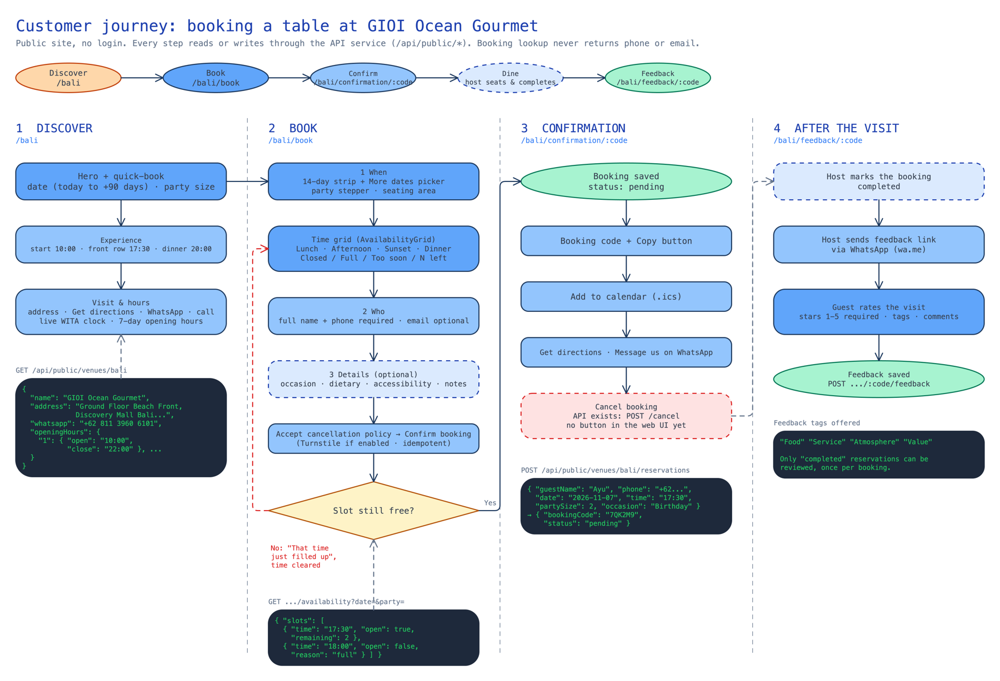
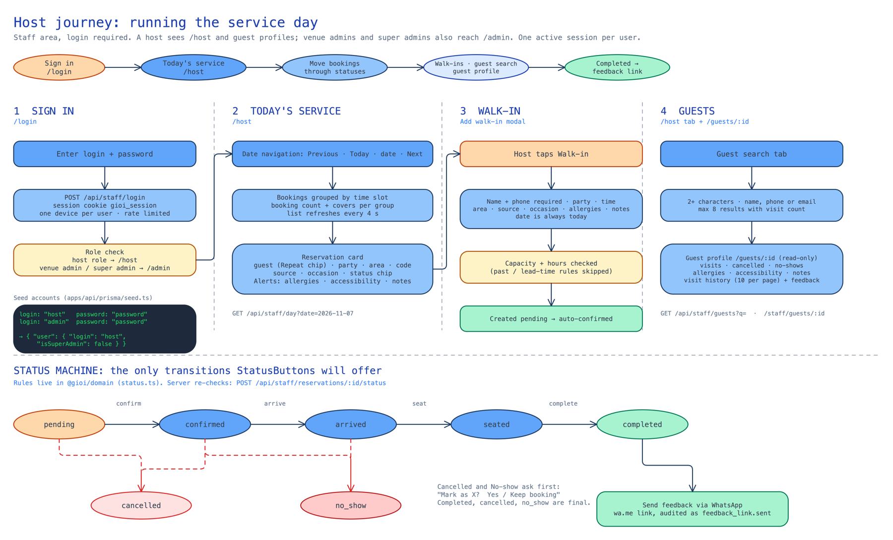
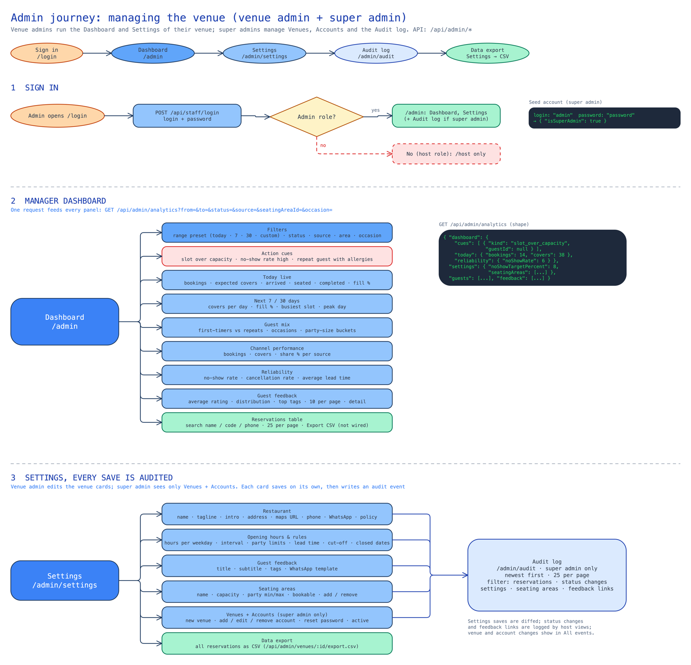
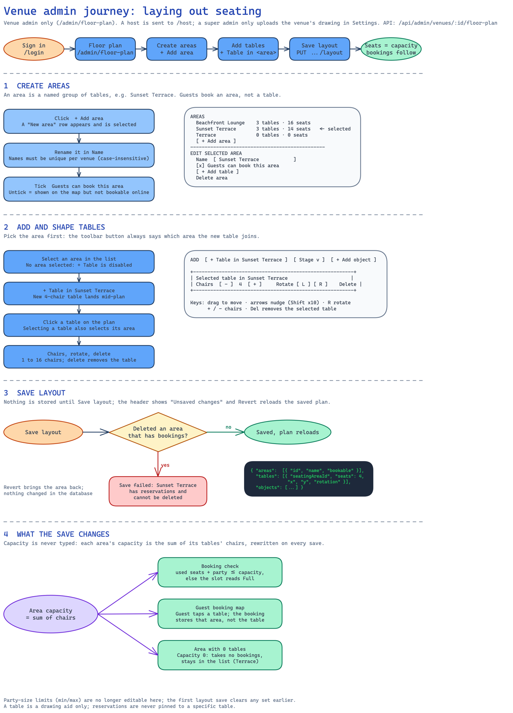
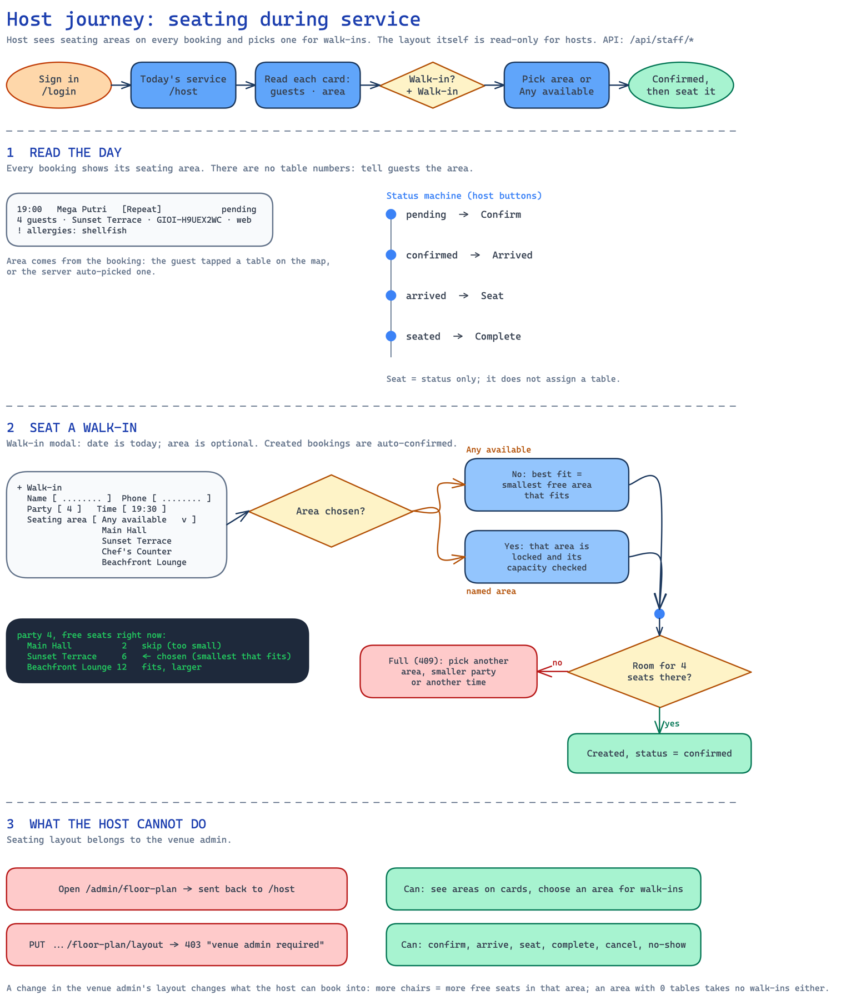
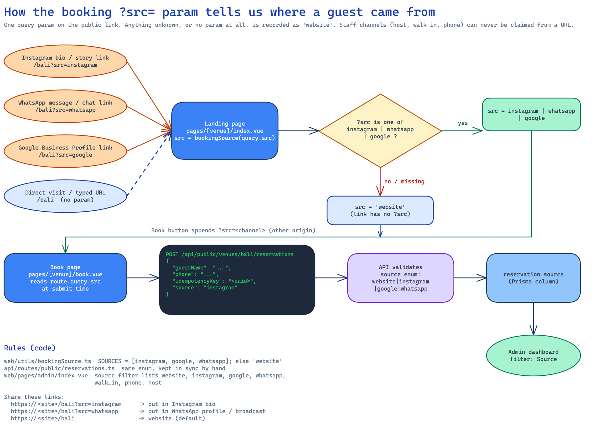
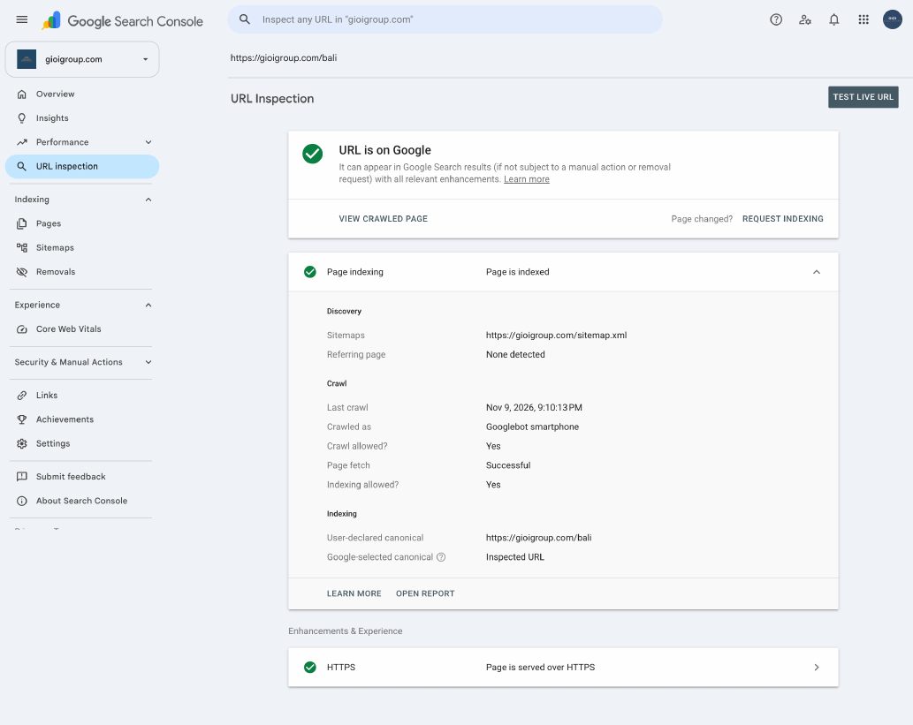
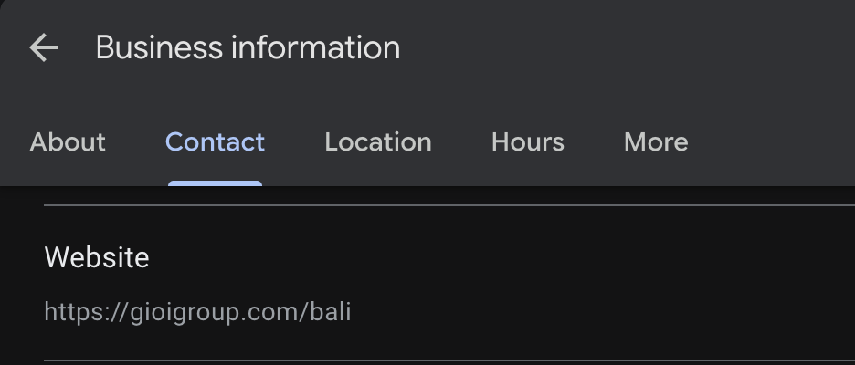
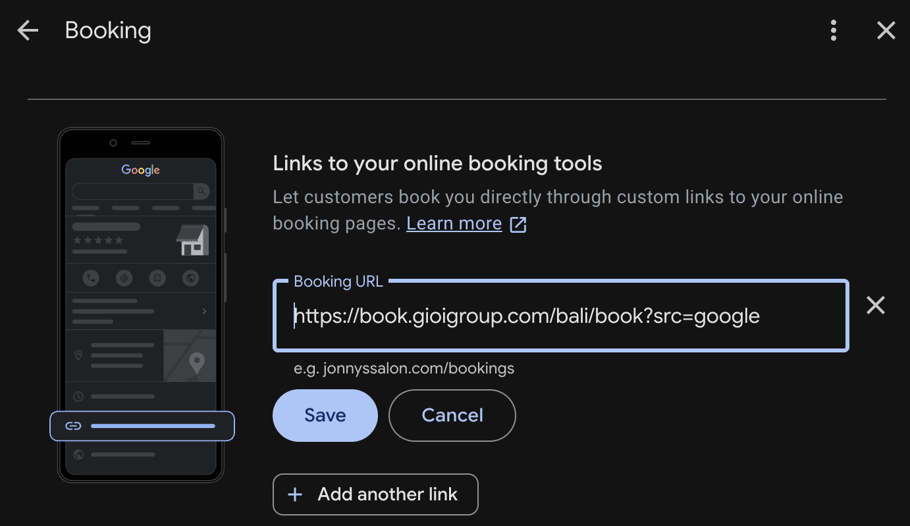
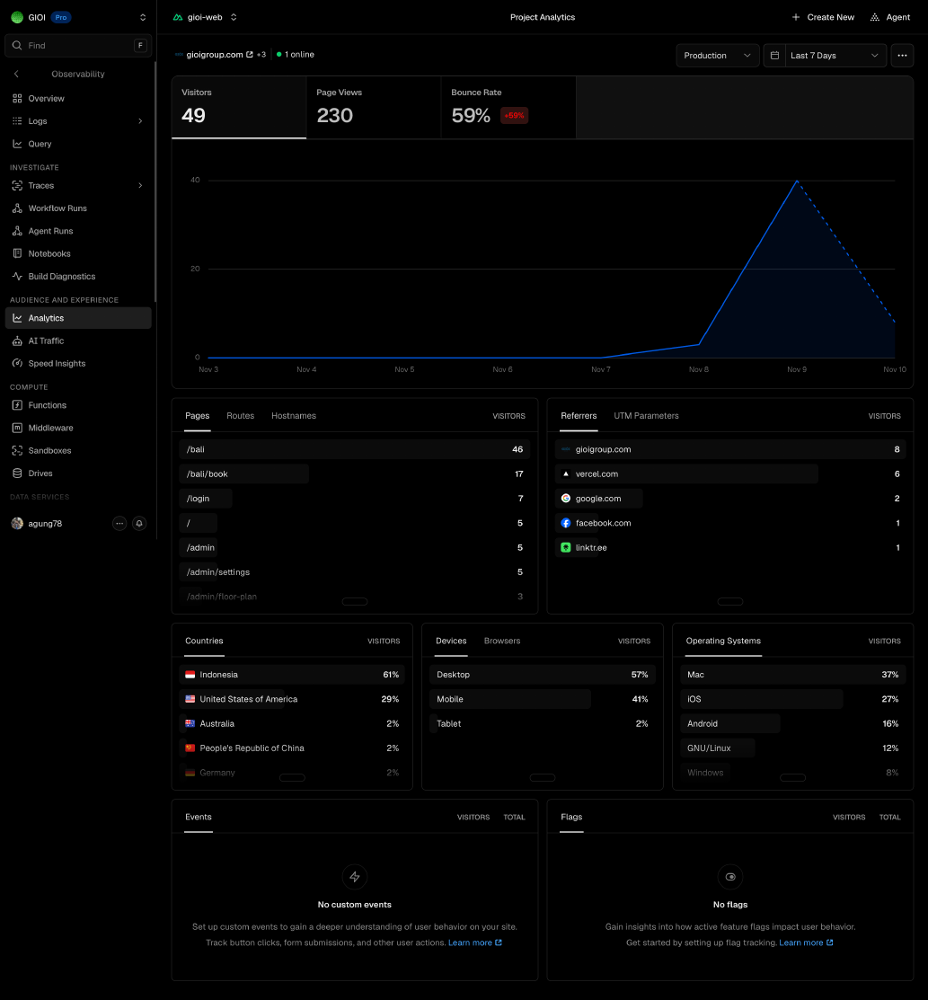

## Executive summary

This report consolidates the Strix penetration test (2026-11-10), the Semgrep / OSV / ZAP scan (2026-11-08), the QA E2E browser run (2026-11-09), a Lighthouse audit of gioigroup.com/bali, Google Search Console indexing, Google Business Profile links, the SEO organic estimate, the journey diagrams and Vercel Web Analytics. The pentest found three medium-severity issues and no high or critical ones. All three are fixed in commit adf2181 (CSV escaping is covered by a passing unit test; the CORS and dev-server changes are code-reviewed but not yet re-scanned). The public page scores 100 in every Lighthouse category and is indexed by Google.

::: stats
3 | Pentest findings, all medium | orange
3 of 3 | Fixed in adf2181 | green
162 of 196 | QA scenarios passing | blue
100 | Lighthouse, all 4 scores | tan
:::

### Pentest findings and fixes

| ID | Finding | CWE / CVSS | Fix applied | Status |
|---|---|---|---|---|
| vuln-0001 | Reflected credentialed CORS: arbitrary Origin echoed with Allow-Credentials, so a hostile site could read /admin/venues for a logged-in user | CWE-942 / 4.3 | apps/api/src/index.ts: origin is now an explicit CORS_ORIGIN allowlist; unset means no cross-origin access (was `true`). The CSRF origin hook uses the same list | Fixed, retest pending |
| vuln-0002 | Nuxt dev server on :3002 served raw source, /_nuxt/@fs paths and Vite internals without authentication | CWE-200 / 5.3 | apps/web/nuxt.config.ts: devServer binds to 127.0.0.1 unless NUXT_DEV_HOST is set. README: exposed environments must use nuxt build. API listens on HOST (default 127.0.0.1) | Fixed, retest pending |
| vuln-0003 | CSV formula injection: public guestName such as `=HYPERLINK(...)` exported unchanged by /admin/venues/:id/export.csv | CWE-1236 / 4.3 | New apps/api/src/lib/csv.ts csvEscape prefixes a single quote when a value starts (after whitespace) with = + - @ or tab/CR; the export route uses it for every field | Fixed, unit test passes |

> Verified in this run: apps/api csv.test.ts passes (2 tests). The CORS and dev-server fixes were read in the diff but the Strix scan was not re-run against them.

#### Cleared by the pentest

Unauthenticated /staff/* and /admin/* calls return authorization errors, and host and venue-admin users cannot perform super-admin actions. Cross-venue guest and reservation access is blocked. Public mass-assignment fields are ignored and booking codes resisted guessing. Guest names and notes render as escaped text (no stored XSS), and SQL, NoSQL, template, command, SSRF and XXE probes found nothing. Login errors do not reveal usernames; session cookies are HttpOnly, Secure and SameSite=Lax; logout invalidates the session.

## Penetration test detail

Strix ran an authorized, non-destructive black-box test against the Nuxt frontend (:3002) and the Fastify API (:3001), using the seeded admin, host and venueadmin roles. /ingest/** was excluded. The source repository was not mounted during the run, so there was no static source review.

### vuln-0001 · Reflected credentialed CORS (Medium)

Request `GET /admin/venues` with `Origin: http://evil.example` and a valid gioi_session cookie returned 200 with `Access-Control-Allow-Origin: http://evil.example` and `Access-Control-Allow-Credentials: true`. The same call without the cookie returned 401, so exposure needs a logged-in victim visiting a hostile page. The pre-fix code passed `origin: allowedOrigins ?? true`, which reflects any origin when CORS_ORIGIN is unset.

**Retest:** an untrusted or `null` origin must receive neither Access-Control-Allow-Origin nor credentialed responses. Production must set CORS_ORIGIN to the book. and admin. hosts only.

### vuln-0002 · Nuxt dev server exposes source (Medium)

`GET /_nuxt/composables/useApi.ts` and `/_nuxt/stores/auth.ts` returned 200 with raw TypeScript showing the staff and admin API map. The HTML also leaked absolute developer paths under /_nuxt/@fs/ and served about 180 KB of Vite runtime at /_nuxt/@vite/client. The production deployment on Vercel serves a built bundle, so the exposure was the local dev server reached from the scanner container.

**Retest:** with default settings the dev server must refuse connections from other hosts. Any shared environment must run `nuxt build`; source maps, @fs and @vite/client must return 404.

### vuln-0003 · CSV formula injection (Medium)

A public reservation with `guestName` set to `=HYPERLINK("http://x","x")` was accepted (booking GIOI-V93TGH7M) and appeared verbatim in the admin CSV export, where a spreadsheet would evaluate it. Quoting only protects delimiters, not formulas.

**Retest:** open an export containing `=`, `+`, `-`, `@` and leading-whitespace payloads in a spreadsheet; they must display as text while ordinary reservation data stays unchanged.

## Dependency and header scans

Both apps were scanned on commit f61b15f (2026-11-08) with Semgrep (SAST), OSV.dev via cve-mcp-server (SCA) and OWASP ZAP baseline (DAST). Findings below are unchanged from that report.

### SAST · Semgrep

389 and 390 rules ran on 47 (api) and 41 (web) tracked files with 0 findings.

### SCA · OSV.dev

| Package | Advisory | Severity | EPSS | Status |
|---|---|---|---|---|
| vitest | GHSA-5xrq-8626-4rwp | Critical | 0.0103 | Fixed (2.1.9 to 4.1.12) |
| vitest | GHSA-82fw-gwwq-j7x9 | Moderate | 0.0053 | Fixed (2.1.9 to 4.1.12) |
| happy-dom | GHSA-37j7 / 5fpq / 6q6h / c8p4 / w4gp | Mixed | ≤ 0.0065 | Fixed (15.11.7 to ^21) |
| nuxt | GHSA-vjh5-4x84-xrqp | Moderate | 0.0042 | Open (Nuxt 4) |
| nuxt | GHSA-jjm6-p2m9-9w4x | Low | 0.0041 | Open, inactive path |
| nuxt | GHSA-xfq5-w38q-pc2x | n/a | 0.0022 | Open, inactive path |

> Fixed packages are devDependencies and not shipped to production. The three open nuxt advisories are fixed only in Nuxt 4; an upgrade to 4.6.4 was tried and reverted (@pinia/nuxt incompatible, /bali prerender returned 500). Only CVE-2026-114132 (routeRules skipped for case-variant paths) touches this app, because /admin/**, /host and /guests/** rely on routeRules.

### DAST · OWASP ZAP baseline (passive)

API: 67 pass, 1 warn (cacheable 404s); the spider reached only the root. Web: 58 pass, 10 warn, 0 fail across 46 URLs. All warnings are hardening gaps.

| Alert | ID | Fix |
|---|---|---|
| Content Security Policy not set | 10038 | Add Content-Security-Policy via routeRules headers |
| Missing anti-clickjacking header | 10020 | X-Frame-Options or frame-ancestors |
| X-Content-Type-Options missing | 10021 | nosniff |
| Permissions Policy not set | 10063 | Add Permissions-Policy |
| Cross-Origin-Embedder-Policy missing | 90004 | Add COEP header |
| X-Powered-By disclosure | 10037 | Disable the header in nitro config |
| Sub Resource Integrity missing | 90003 | Add integrity to external assets |
| Cacheable content / cross-domain | 10049, 10098 | Review cache headers |

## QA E2E browser scenarios

Run of 2026-11-07 to 2026-11-09 on a seeded dev database (Chromium plus curl) across customer, host and admin journeys. 196 scenarios carry a status.

::: stats
162 | Passed | green
3 | Failed | orange
31 | Not run | blue
196 | Scenarios | tan
:::

### Failed scenarios

| ID | P | Scenario | Result |
|---|---|---|---|
| G-12 | P1 | Required fields on booking | Confirm is disabled until name and phone are valid, but no inline error messages are shown |
| D-11 | P1 | Dashboard Export CSV button | Button has no handler; the export works from Settings -> Data export |
| U-05 | P1 | Console clean | Dev-only hydration mismatch on /bali (cause not isolated) |

### Security smoke checks (section 10)

All eight checks passed: 401 without a cookie, old cookie rejected after login elsewhere, no PII on public booking lookup, XSS payloads rendered as text, SQL-style search treated literally, tampered UUIDs return 403 or 404, garbage bodies return 4xx never 500, and error bodies are `{ error, message }` without stack traces.

### Known gaps

- Login rate limiting is in-memory per serverless instance; a shared store is needed for real brute-force protection.
- Sessions have a fixed 7-day life (no sliding expiry).
- Guest cancel exists only as an API; the confirmation page has no button.
- The super admin can still edit venue settings through the API even though the UI hides those sections.
- 31 scenarios not run, including keyboard (U-03), reduced motion (U-04), API-down states (U-06, D-14) and the zero-venue bootstrap paths (B-02 to B-04).

## Journey: Customer

Discover, book, confirmation and feedback (public, no login). Scenarios G-01 to G-30.

## Journey: Host

Sign in, today's service and status machine, walk-ins and guests. Scenarios A-01 to A-14, H-*, W-*, S-*.

## Journey: Admin

Sign in and role gate, dashboard, settings, audit log, venues and accounts. Scenarios R-*, D-*, T-*, L-*.

## Journey: Seating: admin

Floor plan editor: areas, tables, drawing upload, capacity from seats. Scenarios F-01 to F-22.

## Journey: Seating: host

Seating map on the booking page and host view. Scenarios G-31 to G-43.

## Journey: Booking source tracking

How the src parameter (for example src=google from the Business Profile link) is stored and reported per reservation.

## Performance, search and traffic

### Lighthouse · gioigroup.com/bali (desktop, 2026-11-10)

::: stats
100 | Performance | green
100 | Accessibility | green
100 | Best Practices | green
100 | SEO | green
:::

Agentic Browsing scores 3 of 3. Core metrics: First Contentful Paint 0.4 s, Largest Contentful Paint 0.8 s, Total Blocking Time 0 ms, Cumulative Layout Shift 0.001, Speed Index 0.7 s. Lighthouse 13.5.0, Chromium 157, single page session.

| Opportunity | Estimate |
|---|---|
| Improve image delivery | 449 KiB |
| Reduce unused JavaScript | 88 KiB |
| Legacy JavaScript | 9 KiB |
| Efficient cache lifetimes | 1 KiB |
| Back/forward cache restoration | 1 failure reason |

Best Practices also flags three trust items that tie to the DAST findings: ensure CSP is effective against XSS, use a strong HSTS policy, and mitigate DOM-based XSS with Trusted Types.

## Search indexing

### Google Search Console · URL inspection

https://gioigroup.com/bali is on Google and page indexing is passed: sitemap https://gioigroup.com/sitemap.xml, last crawl Nov 9, 2026 by Googlebot smartphone, crawl allowed, page fetch successful, indexing allowed, Google-selected canonical equals the declared canonical, and the page is served over HTTPS.

## SEO and local presence

Source: docs/seo-organic-estimate.md (scope apps/web, 2026-11-09). Search Console now confirms `/bali` is indexed, which resolves the main open question in that estimate. Ranking and traffic ranges below are planning assumptions, not measurements.

### Current state

| Area | Status |
|---|---|
| Indexable pages | 2: /bali and /privacy. Booking, confirmation and feedback send X-Robots-Tag noindex; staff pages are disallowed; unknown venue slugs return 404 |
| On-page SEO | Title, description, canonical, og:* and twitter:* tags, descriptive image alt text. English plus Indonesian keywords on /bali only (no /id route or hreflang) |
| Structured data | Restaurant JSON-LD with address, E.164 phone, opening hours, geo, price range (IDR 250,000 to 300,000), menus, ReserveAction to /bali/book. No postalCode |
| Content | About 135 words; menus are PDFs (food menu 2.7 MB). Thin for a ranking page |
| Sitemap / robots | sitemap.xml lists / and venue slugs but not /privacy; robots.txt disallows staff paths |
| Off-page | No known backlinks or review data. On 2026-11-09 Google AI Overview for "gioi gourmet ocean reservasi" listed WhatsApp, Chope Bali, Grab Dine Out and Instagram, not the venue's own booking page |

### Google Business Profile

The profile now links the website to https://gioigroup.com/bali and the booking link to https://book.gioigroup.com/bali/book?src=google. The `src=google` parameter attributes bookings to Google (see the booking source tracking journey). This covers the estimate's actions 1 and 13 for links only; hours, menu, photos and reviews were not verified here.

### Growth limits and scenarios

Limits: one ranking page, thin content, a high-competition Kuta local pack, no domain authority yet, and third parties (Chope, Grab, WhatsApp) owning the "reservasi" answer. Brand queries should rank first within weeks of indexing.

| Phase (from indexing) | Conservative | Base | Optimistic |
|---|---|---|---|
| Weeks 0 to 2 | Indexed | Indexed, brand query ranks | Brand #1 |
| Months 1 to 3 | Brand traffic only | Brand plus a few local impressions | Local impressions growing |
| Months 3 to 6 | Little non-brand | Non-brand local page 2 to 3 | Local page 1 |
| Months 6 to 12 | Non-brand still small | Steady local organic plus Maps | Meaningful share of bookings |

> Monthly organic visits at month 6 to 12 before adding pages: conservative tens, base low hundreds, optimistic several hundred. Most discovery will come from Google Maps and the Business Profile.

### Highest-impact actions

| # | Action | Effort |
|---|---|---|
| 1 | Collect and answer real reviews | Ongoing |
| 2 | Add an HTML menu page (/bali/menu) with Menu markup; compress bali-menu.pdf | Medium |
| 3 | Add 300+ words of copy: location, cuisine, hours, directions, FAQ | Medium |
| 4 | Add /privacy to the sitemap; split JSON-LD address and add postalCode | Low |
| 5 | Keep name, address and phone identical across site, GBP and listings | Low |
| 6 | Build local links (Discovery Mall, Bali food blogs, Instagram bio booking link) | Medium |
| 7 | Add an /id/bali page with hreflang if Indonesian queries show impressions | Medium |

## Web analytics

### Vercel Web Analytics · gioi-web, production, last 7 days

::: stats
49 | Visitors | blue
230 | Page views | green
59% | Bounce rate | orange
1 | Online now | tan
:::

Traffic arrived on Nov 8 and peaked on Nov 9. /bali leads with 46 visitors, then /bali/book (17), /login (7), / (5) and /admin (5). Desktop is 57% of visitors, mobile 41% and tablet 2%. Indonesia is 51% and the United States 29%. Referrers are gioigroup.com (8), vercel.com (6) and google.com (2). No custom events or flags are configured. Admin and login paths appear in the public analytics, so part of the sample is staff and test traffic.

## Next steps

| # | Action | Why | Effort |
|---|---|---|---|
| 1 | Set CORS_ORIGIN in the production API project (book. and admin. hosts only) and re-run Strix against a built, non-dev frontend | Confirms vuln-0001 and vuln-0002 are closed | Small |
| 2 | Add security headers in nuxt.config.ts routeRules (CSP, X-Frame-Options, nosniff, Permissions-Policy, COEP, HSTS) | Clears 9 of 10 ZAP warnings and the Lighthouse trust audits | Small |
| 3 | Add regression tests for CORS origins and a CSV export route test with formula payloads | Pentest recommends them; only csvEscape is unit tested today | Small |
| 4 | Fix G-12 (inline errors) and D-11 (wire or remove the Export CSV button), then isolate the U-05 hydration mismatch | The 3 failed QA scenarios | Small |
| 5 | Move login rate limiting to a shared store | In-memory limit is per serverless instance | Medium |
| 6 | Migrate web to Nuxt 4 (pinia 3.x, fix /bali prerender, app/ layout) | Closes the last three nuxt advisories including the routeRules bypass | Medium |
| 7 | Convert large images to modern formats and trim unused JavaScript | About 449 KiB and 88 KiB of Lighthouse savings | Small |
| 8 | Work the SEO actions (reviews, HTML menu page, more copy, sitemap /privacy) and track Search Console impressions weekly | Organic is a small channel until content and reviews compound | Medium |
| 9 | Provide an OpenAPI spec for the API and re-run ZAP; wire Semgrep, OSV and ZAP into CI | Current DAST covers only the root path and scans are ad hoc | Small |

> Method and limits: the pentest was black-box with no source access and /ingest/** excluded; ZAP was passive; QA ran on the dev database, not production. Raw outputs: gioi/strix_runs/host-docker-internal-3002_7cee/, /tmp/gioi-{api,web}-semgrep.json, cve-mcp.json, zap/zap-report.json.
